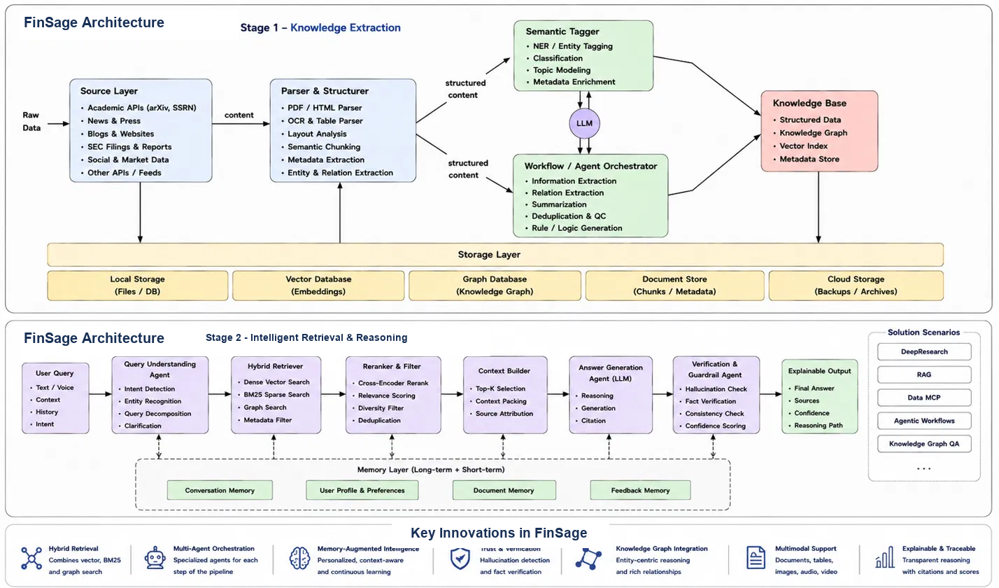

# FinSage

FinSage is an open-source research codebase for building temporally aware, evidence-oriented financial knowledge workflows. It combines deterministic document processing and typed knowledge artifacts with LLM-assisted extraction, conflict analysis, retrieval, and evaluation experiments.

> **Research software in active development.** The repository contains working components and an aspirational system architecture. It does not yet implement every box in the diagram, and no benchmark result or effectiveness claim is made here.

Maintainer: [@abhilashpuli98](https://github.com/abhilashpuli98)

## Overview

Financial research evidence is distributed across papers, news, filings, and other documents. A document-only search result can omit when a claim applies, whether sources disagree, or which passages support an answer. FinSage explores a knowledge-centric approach: represent source material as typed artifacts with provenance and time information, then retrieve and reason over those artifacts.

The Python distribution and import namespace are both `finsage`. The codebase descends from the QuantMind project; its original MIT license and upstream attribution are retained. The migration changes project identity and import paths, not the research lineage.

## Research Motivation

FinSage investigates three practical challenges in financial knowledge systems:

- **Time-sensitive evidence:** empirical findings and market claims have validity periods; point-in-time queries should not silently use later information.
- **Disagreement across sources:** differing estimates or conclusions may reflect a genuine contradiction, different samples, or different methods. Preserve the evidence and resolution rationale rather than silently collapsing it.
- **Reproducible, inspectable processing:** make source handling, model configuration, retrieval evidence, and evaluation procedures visible enough to test.

These are research motivations, not claims that FinSage already solves financial question answering or produces better results than existing systems.

## Architecture

The image is the target research architecture. Its storage, memory, graph, orchestration, verification, and integration boxes describe intended connections; implementation status is documented below.



### Stage 1: Knowledge Extraction and Engineering

The implemented path starts with supported inputs and turns them into typed values:

1. **Source ingestion:** the preprocessing layer includes arXiv, DOI, HTTP/local-file, and RSS acquisition paths; the public news operation currently supports PR Newswire.
2. **Parsing and normalization:** PDF and HTML processing, page-aware parsed documents, text cleaning, outline signals, and time/date helpers are implemented. The diagram's generalized OCR and table-extraction service is not a single integrated capability.
3. **Knowledge construction:** `PaperFlow` produces paper artifacts and structure trees; `collect_news` returns a replayable news batch; `TemporalPaperFlow` extracts temporal knowledge units (TKUs) from supported PDF paper inputs. Inputs and outputs use typed Pydantic models or frozen data classes according to their role.
4. **Temporal representation:** a `TemporalKnowledgeUnit` records an atomic claim, source, validity bounds, confidence, domain, and tags. Helpers support validity checks and collections can be filtered by date or domain. Temporal extraction is LLM-assisted and its inferred dates/domain should be treated as fallible evidence, not ground truth.
5. **Conflict analysis:** the conflict detector prefilters claims by source, domain, and overlapping validity windows, then uses embedding similarity and LLM confirmation. The resolver can record market, period, or methodology-based resolution and contextual synthesis. These are components, not an always-on global conflict service.
6. **Persistence:** `LocalKnowledgeLibrary` stores supported canonical knowledge and paper artifacts in SQLite; it can persist and reopen self-contained structure trees. It builds local semantic-search projections using an embedding provider. There is no integrated cloud backup or separate graph database service.

The current knowledge shapes include flat and tree artifacts. `GraphKnowledge` is a placeholder and cannot be subclassed; a persisted knowledge graph and graph traversal are planned, not implemented.

### Stage 2: Retrieval and Reasoning

The current retrieval tools are separate operations, not one fully integrated multi-agent answer pipeline:

- **Page-aware document retrieval:** `finsage.rag` chunks parsed pages with LlamaIndex and ranks chunks with BM25. Returned evidence retains page and layout provenance.
- **Local semantic search:** `LocalKnowledgeLibrary.search()` searches library-owned text projections and returns typed hits that can be resolved to their stored artifacts. This is separate from document BM25 retrieval.
- **Agentic structure retrieval:** `AgenticRetriever` uses the OpenAI Agents SDK to inspect one self-contained structure tree and select node evidence. Results include evidence content and citations; this is reasoning-based traversal, not graph search or a general query planner.
- **LLM routing:** the knowledge-pipeline `LLMRouter` uses LiteLLM for generation, embeddings, fallback between configured Ollama and API tiers, and in-memory usage/cost estimates. The Agents SDK runtime used by agentic retrieval remains separate.
- **Answer generation and verification:** evaluation code includes LLM-judge scoring, but there is no integrated user-facing answer generator with claim-level citation verification or a runtime hallucination guard.

Hybrid dense-plus-BM25 retrieval, cross-encoder reranking, knowledge-graph reasoning, general multi-agent orchestration, and explainable answer synthesis are target architecture items, not current end-to-end features.

### Shared Memory and Integration

`BaseFlowCfg` currently exposes a `memory_dir` setting, but persistent conversation, user-profile, document, and feedback memory are not integrated. Likewise, the architecture's application scenarios (deep research, financial RAG, knowledge-graph QA, and MCP serving) are directions for integration, not claims of shipped services. Current reusable integration surfaces are Python APIs, command-line examples/scripts, local SQLite storage, OpenAI Agents SDK, LiteLLM, Ollama, and LlamaIndex components.

## Key Research Contributions

The implementation provides testable foundations for the following research questions:

- Can explicit validity windows improve point-in-time retrieval and evaluation?
- Can cross-source conflict detection preserve disagreements and make their context inspectable?
- How do local/API model routing choices affect extraction quality, latency, and estimated cost?
- How do typed, cited paper artifacts compare with simpler retrieval baselines?

The code provides models, operations, and evaluation scaffolding for these questions. Novelty and empirical value require controlled experiments and comparison with appropriate baselines; the presence of a component alone is not a research result.

## Technology Stack

| Area | Technologies and role |
|---|---|
| Runtime and schemas | Python 3.10+, Pydantic 2, frozen dataclasses |
| Agent runtime | OpenAI Agents SDK for agentic structure retrieval |
| Model routing | LiteLLM for knowledge-pipeline calls; Ollama and API model tiers |
| Document processing | PyMuPDF, LiteParse, HTTPX, arXiv client, Trafilatura |
| Retrieval and storage | LlamaIndex BM25, SQLite-backed `LocalKnowledgeLibrary`, configurable embeddings |
| Evaluation | pandas, SciPy, pytest; evaluation models, runner, and judge-based scoring |
| Development checks | Ruff, basedpyright, import-linter, pytest and pytest-cov |

`pyproject.toml` also declares spaCy, ChromaDB, NetworkX, BERTScore, and related dependencies. Their presence as dependencies does not mean FinSage currently provides an integrated NER pipeline, Chroma-backed vector database, graph database, or completed benchmark evaluation.

## Installation

Requirements: Python 3.10 or later and [uv](https://docs.astral.sh/uv/).

```bash
git clone https://github.com/abhilashpuli98/FinSage.git
cd FinSage
uv venv
```

Activate the environment, then install the project and development tools:

```powershell
# Windows PowerShell
.venv\Scripts\Activate.ps1
uv pip install -e ".[dev]"
```

```bash
# macOS / Linux
source .venv/bin/activate
uv pip install -e ".[dev]"
```

The optional `full` extra adds dependencies for optional document/model tooling declared in `pyproject.toml`: `uv pip install -e ".[dev,full]"`.

## Configuration

- **API models:** provide `OPENAI_API_KEY` through the process environment or your secret manager when using OpenAI-backed model calls. Never commit credentials or a populated `.env` file.
- **Local models:** install and start Ollama separately, then configure `OllamaModelCfg` and `RouterCfg`. Defaults include `llama3.2` and `nomic-embed-text`; the router checks local availability and has configured fallback tiers.
- **Paper extraction:** `TemporalPaperCfg` controls model choice, chunk length, TKU limit, and semantic deduplication threshold. `TemporalPaperFlow` accepts the supported typed paper inputs; its current PDF path does not support every input variant.
- **Reproducible runs:** record the model/provider, configuration, source revision, and output directory for each experiment. Router cost values are estimates, not provider invoices.

## Usage Examples

These offline examples use mocks or inspect configuration and do not require API credentials:

```bash
python examples/mind/router.py
python examples/mind/conflict.py
python examples/flows/temporal_paper.py
```

The conflict example mocks model calls. The temporal-paper example uses its mocked demonstration path when `OPENAI_API_KEY` is not set. A live paper extraction requires network access to the source and a configured model provider.

A minimal live temporal extraction follows the same API as [`examples/flows/temporal_paper.py`](examples/flows/temporal_paper.py):

```python
import asyncio

from finsage.configs import TemporalPaperCfg
from finsage.configs.paper import ArxivIdentifier
from finsage.flows import TemporalPaperFlow


async def main() -> None:
    flow = TemporalPaperFlow(TemporalPaperCfg())
    collection = await flow.build(ArxivIdentifier(id="1706.03762v7"))
    print(f"Extracted {len(collection.tkus)} temporal claims")


asyncio.run(main())
```

Further working examples and public operation contracts are indexed in [`docs/README.md`](docs/README.md). Local semantic-library usage is documented in [`docs/library.md`](docs/library.md).

## Implementation Status

| Capability | Status in this checkout |
|---|---|
| Typed flat/tree knowledge and page-cited paper artifacts | Implemented and covered by tests |
| arXiv, DOI, HTTP/local, RSS preprocessing; PR Newswire collection | Implemented for the documented inputs and source |
| Page-aware PDF parsing, deterministic chunking, BM25 retrieval | Implemented components; not a single general-purpose pipeline |
| SQLite local knowledge library and semantic projections | Implemented; semantic search uses a configured embedding provider |
| Temporal knowledge models, date helpers, temporal paper extraction | Implemented; extraction is model-dependent and should be validated |
| Conflict records, candidate filtering, similarity/LLM detection and resolution | Implemented components; no global persistent conflict graph |
| LiteLLM routing with local/API tiers and usage estimates | Implemented for knowledge-pipeline calls |
| Agentic retrieval over self-contained paper structure trees | Implemented using the OpenAI Agents SDK |
| FinBench-50 construction/evaluation code and model quality-cost runner | Implemented as experimental scaffolding; benchmark data/results are not published here |
| Cross-source knowledge graph, integrated hybrid retriever/reranker, persistent user memory, runtime answer verification, MCP service | Planned or not integrated |

The distribution metadata and imports are `finsage`. The package rename does not add compatibility imports under `quantmind`.

## Evaluation Methodology

The evaluation package defines factual, analytical, and temporal question models; a benchmark constructor; six comparison-system implementations; judge-based answer scoring; cached result output; paired comparisons; and an LLM quality/cost runner. The intended comparisons include generic model answering, a basic retrieval baseline, an upstream-style baseline, temporal/conflict ablations, and a combined configuration.

The current scoring code uses an LLM judge for factual and analytical answers. Its temporal score combines judged correctness, a target-year mention, and the presence of a temporal-scope field. The runner records latency and approximate costs; the statistical helper reports paired t-tests and Cohen's d. These implementation choices need calibration and protocol review before scientific use.

The paper list and generated benchmark/results are not included as public evidence in this README. No score, performance improvement, or completed experiment is claimed. Before reporting results, publish or version the dataset and splits, document prompts and model versions, validate baseline implementations, define metrics in advance, and report uncertainty and failure cases. Evaluation commands and live component checks are catalogued in [`docs/README.md`](docs/README.md).

## Research Contributions and Limitations

FinSage's contribution at this stage is an open implementation surface for temporal knowledge extraction, conflict-aware analysis, configurable model routing, document retrieval, and repeatable evaluation experiments. The code is not an investment recommendation system and should not be used as an authoritative source of financial advice.

Important limitations include model-generated extraction errors, heuristic date/domain inference, estimated model costs, limited supported source integrations, no implemented graph storage/reasoning, no integrated long-term memory, and no end-to-end claim-verification workflow. API model behavior and output can vary across providers and versions.

## Reproducibility

For each experiment, retain the exact source identifiers/revisions and permitted source data, data split, FinSage commit, Python/dependency lock, model/provider identifiers, configuration, prompts, retrieval settings, random seeds where applicable, cached raw outputs, scoring procedure, latency/cost estimates, and failure records. Use the evaluation runner's output directory to keep generated results separate from source inputs. Check dataset licenses and provider terms before redistribution. No private datasets, API credentials, model weights, or generated benchmark result files are required to install and test the core repository.

## Roadmap

- Integrate temporal artifacts with storage and retrieval while preserving point-in-time semantics.
- Publish a documented financial benchmark and validate its data, splits, annotation quality, and baselines.
- Evaluate temporal/conflict components with controlled ablations and calibrated judges.
- Investigate graph-shaped knowledge and relationship-aware retrieval.
- Design explicit persistence and privacy policies before implementing cross-session memory.
- Integrate answer generation with claim-level evidence verification and citation checks.
- Measure local/cloud quality, latency, cost, and reproducibility on versioned tasks.

These are research directions; they are not current feature commitments or measured outcomes.

## Contributing

FinSage is maintained by [@abhilashpuli98](https://github.com/abhilashpuli98), and contributions are welcome. Start with [`CONTRIBUTING.md`](CONTRIBUTING.md), open an issue for a substantial design change, and submit a focused pull request from a fork. Keep the existing `finsage` package boundaries, include tests and a focused example for new behavior, and state what verification you ran. Do not include API keys, `.env` files, private datasets, model weights, or generated results. See [`AGENTS.md`](AGENTS.md) for repository architecture and [`docs/README.md`](docs/README.md) for the public operation catalog.

## References

- Original QuantMind project and research context: [arXiv:2509.21507](https://arxiv.org/abs/2509.21507). This citation is preserved as upstream attribution and is not a FinSage publication or experimental result.
- [OpenAI Agents SDK](https://github.com/openai/openai-agents-python)
- [LiteLLM](https://github.com/BerriAI/litellm)
- [LlamaIndex](https://github.com/run-llama/llama_index)
- [Ollama](https://ollama.com/)

## License

The source tree's [`LICENSE`](LICENSE) carries the inherited MIT text and original LLMQuant copyright notice. The personal repository's pre-existing initial commit contains a GPL-3.0 license file; that commit remains in history, and its intended scope is not determined by this README. Review [`LICENSES/README.md`](LICENSES/README.md) before making distribution or compatibility claims. Third-party components retain their own license terms.
